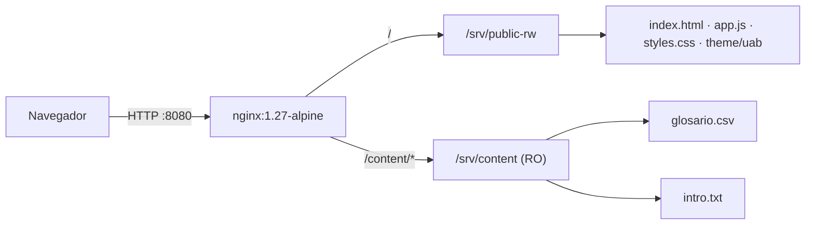

# Annexo 5. Glosario

<i class="fa-solid fa-language"></i> Aplicación web dockerizada que muestra, de forma dinámica y filtrable, un glosario de **palabras de origen chino** recogidas en el Anexo 5 de la guía de estilo: pinyin, caracteres, propuesta en castellano, capítulo, categoría, observaciones y denominaciones desestimadas.

<i class="fa-solid fa-cube"></i> El proyecto se sirve como sitio estático a través de **nginx** y no requiere backend propio: el glosario se lee en el navegador desde un CSV.

---

## <i class="fa-solid fa-list-check"></i> Características

- <i class="fa-solid fa-table"></i> **Tabla dinámica** generada desde `content/glosario.csv`.
- <i class="fa-solid fa-sort"></i> **Ordenación por cualquier columna** (ascendente / descendente) con la columna activa resaltada en verde UAB.
- <i class="fa-solid fa-filter"></i> **Filtros acumulativos por columna** y **búsqueda global** que abarca todas las columnas a la vez.
- <i class="fa-solid fa-arrows-down-to-line"></i> **Scroll infinito**: carga inicial de 20 filas y bloques adicionales de 20 al llegar al final, sin límite de altura.
- <i class="fa-solid fa-hashtag"></i> **Contador de resultados**: «Mostrando X de Y resultados».
- <i class="fa-solid fa-link"></i> **URL compartible**: los filtros y el criterio de orden se reflejan en la URL, de forma que se puede recuperar un estado concreto al recargar.
- <i class="fa-solid fa-circle-info"></i> **Introducción embebida** (`content/intro.txt`) visible por defecto.
- <i class="fa-solid fa-palette"></i> **Interfaz en castellano** con el tema visual de la UAB: barra de prenavegación, cabecera con logo y menú principal, y tipografía corporativa.
- <i class="fa-solid fa-mobile-screen"></i> **Responsive**: adaptado a móvil y tableta, con cabecera de tabla sticky y filtros compactos.

---

## <i class="fa-solid fa-sitemap"></i> Arquitectura



---

## <i class="fa-solid fa-folder-tree"></i> Estructura del proyecto

```text
.
├── README.md
├── compose.yml              # Servicio nginx con volúmenes RO
├── compose.traefik.yml      # Overlay para producción (Traefik + TLS)
├── Dockerfile               # Imagen mínima basada en nginx:1.27-alpine
├── nginx.conf               # Configuración de nginx (root + alias)
├── run.sh                   # Script de arranque (dev / prod)
├── content/                 # Datos (volumen RO)
│   ├── glosario.csv         # Fuente del glosario
│   └── intro.txt            # Texto HTML de la introducción
└── public/                  # Frontend estático (volumen RO)
    ├── index.html
    ├── app.js
    ├── styles.css
    └── theme/
        └── uab/             # Tema visual de la UAB
            ├── css/header-styles.css
            └── img/logo-uab.svg
```

---

## <i class="fa-solid fa-rocket"></i> Puesta en marcha

### <i class="fa-solid fa-circle-check"></i> Requisitos

- Docker y Docker Compose v2 (`docker compose`).

### <i class="fa-solid fa-terminal"></i> Uso de `run.sh`

El proyecto incluye un script `run.sh` que envuelve los comandos de Docker Compose para los dos entornos:

- **`dev`** — arranca solo `compose.yml`. Publica la app en `http://localhost:8080`. Útil para desarrollo local sin TLS ni reverse-proxy.
- **`prod`** — arranca `compose.yml` + `compose.traefik.yml`. No publica puertos: la app se sirve detrás de Traefik (con TLS y `StripPrefix`) bajo `${BASE_URL}${BASE_PATH_PREFIX}`. Requiere que la red externa `proxy` ya exista y que Traefik esté corriendo.

Comandos disponibles:

```bash
./run.sh dev            # Arranca en desarrollo (puerto 8080)
./run.sh prod           # Arranca en producción (vía Traefik)
./run.sh down           # Detiene ambos entornos
./run.sh logs           # Logs en primer plano (dev)
./run.sh logs-prod      # Logs en primer plano (prod)
./run.sh rebuild        # Reconstruye la imagen sin caché y reinicia (dev)
./run.sh rebuild-prod   # Reconstruye la imagen sin caché y reinicia (prod)
./run.sh config         # Muestra la configuración fusionada (dev)
./run.sh config-prod    # Muestra la configuración fusionada (prod)
./run.sh help           # Ayuda
```

Notas:

- **`dev` y `prod` no fuerzan build**: si la imagen no existe, Docker Compose la construye; si ya existe, se reutiliza. Para forzar una reconstrucción completa, usa `rebuild` / `rebuild-prod`.
- **`dev` y `prod` conviven mal en el mismo host** si el puerto 8080 ya está ocupado por otro servicio (por ejemplo, el dashboard de Traefik). En ese caso, usa solo `prod` o cambia el mapeo de puertos en `compose.yml`.
- Los cambios en `public/` y `content/` **no requieren reconstruir**: son volúmenes RO y se reflejan al recargar el navegador.

### <i class="fa-solid fa-play"></i> Arranque manual (sin `run.sh`)

Si prefieres no usar el script:

```bash
docker compose up -d
```

La aplicación queda disponible en `http://localhost:8080`.

### <i class="fa-solid fa-stop"></i> Detener

```bash
docker compose down
```

### <i class="fa-solid fa-rotate"></i> Reconstruir la imagen

Normalmente **no hace falta** reconstruir: los volúmenes `./public` y `./content` están montados en modo solo lectura, por lo que cualquier cambio en esos directorios se refleja al recargar el navegador. Solo es necesario reconstruir si modificas `nginx.conf`, `docker/entrypoint.sh` o el propio `Dockerfile`:

```bash
docker compose build --no-cache
docker compose up -d
```

---

## <i class="fa-solid fa-sliders"></i> Configuración

### <i class="fa-solid fa-server"></i> `nginx.conf`

- `root /srv/public-rw` sirve el frontend estático (`index.html`, `app.js`, `styles.css`, `theme/…`). El `entrypoint.sh` copia `/srv/public` (RO) a `/srv/public-rw` (RW) para poder sustituir `__BASE_PATH__` sin tocar el original.
- `alias /srv/content/…` sirve el CSV y la introducción desde una ruta independiente, evitando conflictos de montaje entre volúmenes RO.

### <i class="fa-solid fa-link"></i> Variables de URL

La aplicación guarda su estado en la barra de direcciones. Parámetros soportados:

| Parámetro     | Significado                                | Ejemplo                |
|---------------|--------------------------------------------|------------------------|
| `sort`        | Columna de ordenación                      | `sort=Categoría`       |
| `dir`         | Dirección (`asc` / `desc`)                 | `dir=asc`              |
| `q`           | Búsqueda global                            | `q=ch`                 |
| `f_<columna>` | Filtro por columna (una clave por columna) | `f_Categoría=gastronomía` |

Ejemplo de URL restaurable:

```text
http://localhost:8080/?sort=Capítulo&dir=asc&q=a&f_Categoría=gastronomía
```

---

## <i class="fa-solid fa-database"></i> Fuente de datos

El glosario principal vive en `content/glosario.csv`, con las siguientes columnas:

```csv
"Pinyin","Caracteres","Español","Capítulo","Categoría","Observaciones","Denominaciones desestimadas"
```

El frontend no asume más columnas que las declaradas en la cabecera del CSV: si añades nuevas columnas, aparecerán automáticamente en la tabla, serán ordenables y filtrables, y se incluirán en la búsqueda global.

---

## <i class="fa-solid fa-code"></i> Desarrollo

### <i class="fa-solid fa-pen-to-square"></i> Editar el frontend

Los cambios en `public/index.html`, `public/app.js` o `public/styles.css` se reflejan al recargar la página (Ctrl+Shift+R para saltar la caché), porque `./public` está montado como volumen RO en `/srv/public`.

### <i class="fa-solid fa-file-csv"></i> Editar los datos

Los cambios en `content/glosario.csv` o `content/intro.txt` también se reflejan al recargar, porque `./content` está montado en `/srv/content`.

---

## <i class="fa-solid fa-brush"></i> Personalización del tema

El tema visual se inspira en el sitio de Publicacions de la UAB. Vive en `public/theme/uab/`:

- `css/header-styles.css`: estilos del header, aislados bajo `.uab-header-wrapper` para no interferir con la tabla.
- `img/logo-uab.svg`: logo. Sustitúyelo por el oficial si lo tienes.

Para cambiar de tema, crea una carpeta hermana (`public/theme/<nombre>/`) y referencia sus ficheros desde `index.html`. No hay build step: es HTML, CSS y JS planos.

---

## <i class="fa-solid fa-wrench"></i> Solución de problemas

| Problema                                            | Causa / solución                                                                              |
|-----------------------------------------------------|-----------------------------------------------------------------------------------------------|
| El CSV devuelve 404                                 | Comprueba que `content/glosario.csv` existe y que el volumen RO está bien montado.            |
| La tabla no muestra datos                           | Abre la consola del navegador y revisa si `fetch('./content/glosario.csv')` devuelve 200.     |
| Los filtros no responden al instante                | Comportamiento intencionado: hay un *debounce* de 250 ms para no re-renderizar en cada tecla. |
| El header de la tabla no queda fijo al hacer scroll | Asegúrate de que `.table-wrapper` no tiene `overflow: auto` ni `overflow-x` en el breakpoint. |
| Cambios en `public/` no se reflejan                 | Recarga forzada con Ctrl+Shift+R; nginx envía `Cache-Control: no-cache` para HTML/CSS/JS.     |
| `Bind for 0.0.0.0:8080 failed`                      | Otro servicio (p. ej. Traefik) ocupa el 8080. Cambia el mapeo en `compose.yml` o usa solo `prod`.|
| Las cajas de filtro se ven redondeadas en Firefox   | Ya corregido con `appearance: none` + `border-radius: 0 !important`. Si persiste, revisa que no haya caché agresiva (Ctrl+Shift+R). |

---

## <i class="fa-solid fa-scale-balanced"></i> Licencia

Este proyecto se distribuye bajo la licencia **GNU General Public License v3.0 (GPLv3)**.

El *copyright* del código pertenece al **Servei de Publicacions de la Universitat Autònoma de Barcelona (UAB)**.

---

Desarrollado por **Marc Bria Ramírez** para el Servei de Publicacions de la Universitat Autònoma de Barcelona (UAB).
